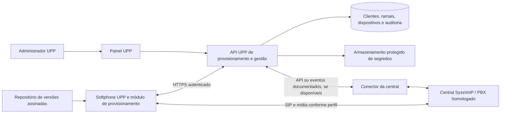

# Especificação do Softphone UPP baseado no MicroSIP

**Documento:** UPP-SIP-ESP-001 · **Versão:** 1.0 · **Data:** 15/10/2026  
**Situação:** proposta de escopo, entregáveis e homologação; implementação e resultados de testes não atestados.  
**Base examinada:** cópia local Upphone SIP 1.3.1, derivada do MicroSIP Lite 3.22.16.  
**Entrega desta atividade:** somente este documento. Nenhuma alteração em código, licença, instalador ou configuração; nenhum novo executável gerado ou testado.

## 1. Objetivo e decisão de produto

Entregar um softphone Windows com a marca UPP, ativação simples e administração centralizada das configurações dos ramais. O usuário deverá instalar, ativar e telefonar sem preencher servidor, domínio, autenticação, transporte ou codecs.

A telefonia continuará sob responsabilidade da central/PBX. A plataforma UPP administrará clientes, usuários, ramais, dispositivos, configurações, versões e diagnóstico. A central SyssVoIP foi indicada pela UPP como ambiente inicial de referência; versões, módulos contratados e particularidades de cada cliente ainda precisam ser inventariados.

O novo `.exe` somente poderá ser liberado para um perfil de cliente após homologação do artefato efetivamente distribuído. A homologação deverá responder separadamente se ele recebe chamadas de fila, permite operar o agente e é corretamente monitorado pela central. Indicadores de filas no painel UPP exigem integração própria e evidência adicional.

O modelo comercial proposto combina distribuição do aplicativo sob GPLv3 com serviços pagos de implantação, provisionamento, hospedagem, suporte e gestão. A regularidade do conjunto depende também das licenças de terceiros descritas na seção 10.

## 2. Situação encontrada no projeto

Esta seção registra evidências de leitura do código e da documentação, sem substituir testes de execução. Relatos de testes anteriores no histórico não homologam uma nova compilação.

| Área | Evidência atual | Consequência para o escopo |
|---|---|---|
| Aplicativo e marca | `const.h:20`, `README.md`: Upphone 1.3.1, MicroSIP Lite 3.22.16, português, identidade UPP e temas claro/escuro | Reaproveitar o trabalho existente; customização visual é evolução |
| Build e distribuição | `build/build.ps1`, `build/Upphone.iss`, `build/pins.ps1`: Win32/x64, instalador Inno Setup, dependências fixadas | Acrescentar ativação, assinatura obrigatória na distribuição aprovada, documentação e pacote de fontes |
| Instalação | `build/Upphone.iss:20`: instalação administrativa em Arquivos de Programas, dados por usuário | Testar técnico instalador e usuário final distintos; não cifrar credenciais no perfil do técnico |
| Conta SIP | `settings.cpp:374` e `:540`: conta lida e gravada em INI | Há base de configuração individual; não há evidência de ativação remota completa |
| Preferências fixas | `settings.cpp:593`, `mainDlg.cpp:2433`: parâmetros gerais fixados e tela geral desativada | Um gerador de INI sozinho não controla todos os requisitos |
| Edição de conta | `AccountDlg.cpp:181`: deriva usuário/autenticação do nome e domínio/proxy do servidor; ao salvar força UDP e desativa SRTP | Provisionamento deverá preservar campos distintos e sobreviver a reinício/edição da conta |
| Proteção da senha | `settings.cpp:90`: DPAPI; `:120`: fallback para proteção legada em caso de falha | Cifrar no usuário de destino; especificar erro seguro sem retornar à proteção legada |
| Atualização | `mainDlg.cpp:5984`, `define.h:75`: consulta release UPP no GitHub e oferece página de download | Aviso de atualização já existe; instalação automática, aprovação por cliente e reversão são novos requisitos |
| Mídia e segurança SIP | `settings.cpp:616`: G.711 A-law, G.711 u-law e G.729; `build/pjproject/config_site.h:9`: SRTP compilado, SSL sockets/DTLS desligados | O perfil atual não entrega SIP TLS/SRTP habilitados; exigir evolução e negociação comprovada |
| Operação de chamadas | `settings.cpp:608`: chamada única; `Transfer.cpp:256`: assistida depende de configuração hoje desativada | Não apresentar transferência assistida ou múltiplas chamadas como homologadas |
| Presença e filas | `mainDlg.cpp:1238` e `:6180`: presença de contatos/assinaturas SIP | Presença não comprova fila, pausa de agente, supervisão ou indicadores de atendimento |
| Gestão centralizada | Não foi identificado backend de provisionamento/gestão na árvore; histórico lista provisionamento como pendência | API, banco administrativo, painel, identidade de dispositivo e auditoria são entregas novas |
| Diagnóstico | Logs SIP desativados por padrão; dumps locais e envio ao MicroSIP desativado | Criar coleta controlada e sanitizada; histórico local de chamadas não é painel remoto |
| Homologação | `docs/HISTORICO.md`, seção 7: chamada real no PBX e G.729 forçado ainda pendentes | Exigir chamadas reais, redes dos clientes e teste específico de filas |

### 2.1. SyssVoIP e limites da consulta pública

A UPP informou os endereços [site SyssVoIP](https://www.syssvoip.com.br/) e [dashboard PBX Unificado](https://www.syssvoip.com.br/pbx-unificado/dashboard). Em 15/10/2026, ambos responderam HTTP 200, sem redirecionamento, com a mesma página básica que pede JavaScript. Isso não comprova acesso a um painel operacional, autenticação ou mesmo uma tela de login. O conteúdo dinâmico não foi validado; não foram consultados dados de clientes ou configurações autenticadas.

A apresentação pública indexada do fornecedor anuncia PBX Unificado, monitoramento de ramais/filas/troncos, relatórios e integrações por API/webhooks. São capacidades anunciadas, sem comprovação nesta atividade de disponibilidade no contrato da UPP ou compatibilidade com o executável. O conteúdo indexado pode diferir da página renderizada atual. [Fonte: apresentação oficial SyssVoIP](https://www.syssvoip.com.br/).

Não se presume a tecnologia interna da central, disponibilidade de AMI/ARI, API de provisionamento, eventos de fila, licenças de supervisão ou suporte a TLS/SRTP. O entregável E01 deverá confirmar, com documentação do fornecedor e ambiente de homologação, quais funções estão disponíveis para a UPP. O endereço do dashboard não deve ser utilizado como endpoint de provisionamento sem contrato de API documentado.

## 3. Escopo funcional e prioridades

**Obrigatório:** requisito necessário para a fase correspondente. **Condicional:** obrigatório quando o recurso fizer parte do perfil contratado do cliente. **Opcional:** depende de contratação/decisão específica e não integra o aceite básico.

| ID | Requisito | Prioridade / fase | Critério de aceite |
|---|---|---|---|
| RF01 | Cadastrar clientes, usuários e ramais, com vínculo à central e ambiente | Obrigatório / F1 | Ramal associado ao cliente correto; cadastro UPP distingue vínculo de ramal existente de criação efetiva no PBX |
| RF02 | Gerar configuração individual versionada, validada e auditável | Obrigatório / F1 | Perfil inclui parâmetros suportados e rejeita incompatibilidades antes da aplicação |
| RF03 | Emitir código/token temporário de ativação | Obrigatório / F1 | Uso único, expiração, revogação, limite de tentativas e vínculo ao cliente/ramal/ambiente |
| RF04 | Aplicar configuração automaticamente e proteger credenciais | Obrigatório / F1 | Instalação de teste registra sem digitação de parâmetros SIP; persistência no contexto do usuário final |
| RF05 | Registrar dispositivo, usuário, versão e resultado de ativação | Obrigatório / F1 | Identificador emitido pelo backend, credencial individual e confirmação da versão aplicada |
| RF06 | Recuperar/redefinir configuração e trocar de conta | Obrigatório / F1, interface F2 | Revoga vínculo anterior quando previsto, limpa segredos e exige nova ativação; não mistura clientes |
| RF07 | Disponibilizar instalador UPP com fluxo inicial de ativação | Obrigatório / F2 | Instalação limpa, atualização e desinstalação aprovadas para cada arquitetura suportada |
| RF08 | Oferecer instalação previamente preparada para o cliente | Obrigatório / F2 | Pacote individual usa bootstrap de uso único; não incorpora senha SIP no executável ou URL |
| RF09 | Exibir ramal, nome, dispositivo e estados compreensíveis | Obrigatório / F2 | Diferencia ativação, conexão com UPP, registro SIP e falha de áudio |
| RF10 | Permitir selecionar/testar microfone e alto-falante | Obrigatório / F2 | Usuário comum realiza teste e troca headset sem acesso aos parâmetros técnicos |
| RF11 | Manter histórico de chamadas local, se habilitado | Condicional / F2 | Preserva histórico nas atualizações; aplica retenção e limpeza por política |
| RF12 | Painel administrativo completo | Obrigatório / F3 | Busca, edição, filtro por cliente, dispositivo, versão, falha de registro e último contato |
| RF13 | Alterar parâmetros remotamente com confirmação de aplicação | Obrigatório / F3 | Configuração desejada e aplicada têm revisões distintas; mudança em chamada fica pendente |
| RF14 | Revogar ativação, bloquear dispositivo e reenviar configuração | Obrigatório / F1 básico, F3 integrado | Reenvio gera nova autorização; bloqueio reporta separadamente resultado na API e no PBX |
| RF15 | Mostrar disponibilidade e falhas de conexão | Obrigatório / F3 | Exibe origem e horário do estado; perda de telemetria não vira falso status SIP offline |
| RF16 | Atualizar executável de forma controlada | Obrigatório / F3 | Canais, grupos de clientes, janela de manutenção, pausa de distribuição e reversão testada |
| RF17 | Consultar logs técnicos e auditoria | Obrigatório / F1 local, F3 central | Logs sanitizados, acesso por perfil, retenção definida e trilha das alterações |
| RF18 | Operar em desenvolvimento, homologação e produção | Obrigatório / todas | Credenciais e dados isolados; token de um ambiente não funciona em outro |
| RF19 | Receber chamadas de filas e verificar monitoramento pela central | Condicional / F1–F2 e toda release | Laudo por central/versão/configuração e pelo `.exe` exato; conclusão explícita de suporte e aprovação dos recursos contratados |
| RF20 | Login/logout, pausa/despausa e pós-atendimento do agente | Condicional / F3, interface F4 | Método suportado pela central, com confirmação do estado efetivo |
| RF21 | Mostrar métricas e estados de fila no painel UPP | Condicional / F3 | Conector homologado e reconciliação com a central; indisponibilidade explícita quando não houver integração |
| RF22 | Refinar interface UPP e proteger funções administrativas | Obrigatório / F4 | Cliente opera chamadas/áudio/conta sem editar segredos ou perfil técnico; suporte usa acesso controlado |

Ficam fora do escopo básico: desenvolver um PBX, discador preditivo, gravação própria de chamadas, aplicativo móvel, versão macOS/Linux e supervisão de áudio. Escuta, sussurro/coaching e intervenção serão itens separados se contratados. Não se promete compatibilidade universal com todos os Windows, PBXs ou headsets.

## 4. Arquitetura proposta e responsabilidades

O softphone realiza chamadas e apresenta estados locais. O módulo de provisionamento autentica o dispositivo, recebe o perfil e aplica as configurações. O backend UPP controla identidade, autorização, versões e auditoria. A central é a fonte de verdade para registro observado pelo PBX, chamadas, agentes e filas. Uma falha da API UPP não deverá interromper uma chamada SIP já estabelecida.

Na F1, manter o motor e a interface de telefonia existentes e criar um provisionador separado. Para o fork atual, a prova de conceito deverá demonstrar que os campos necessários podem ser aplicados sem serem sobrescritos pelo código. Parâmetros fixos incompatíveis deverão resultar em perfil recusado ou evolução posterior do aplicativo; nunca em falsa confirmação de sucesso.

### 4.1. Dados mínimos

| Entidade | Dados essenciais |
|---|---|
| Cliente | Identificador, nome, situação, ambientes e perfis autorizados |
| Usuário | Identificador, cliente, nome, papel e situação |
| Central | Fornecedor, instância, versão, ambiente, capacidades e referência segura de autenticação |
| Ramal | Cliente, usuário, central, identificador no PBX, estado administrativo e referência ao segredo |
| Perfil | Servidor, domínio, usuário SIP, auth ID, proxy, porta, transporte, codecs, DTMF, NAT, temporizadores e política de mídia |
| Configuração | Revisão, versão do esquema, alvo, autor, data, validação, estado desejado/aplicado e motivo de falha |
| Dispositivo | Identificador, cliente/usuário/ramal, credencial própria, Windows/build/arquitetura, versão UPP, primeiro/último contato e revogação |
| Ativação | Resumo criptográfico do token, validade, vínculo, tentativas, consumo e revogação |
| Release | Versão UPP e base MicroSIP, commit, dependências, hash, assinatura, canal, compatibilidade e aprovação |
| Evento/auditoria | Ator, cliente, alvo, ação, correlação, horário, resultado e alterações sem valores secretos |
| Estado de telefonia | Origem da informação, ramal/agente/fila, estado, horário observado e prazo de validade |

O número do ramal não será chave global: clientes diferentes podem usar a mesma numeração. O backend derivará o cliente permitido da identidade autenticada, inclusive em consultas, exportações, logs e tarefas em segundo plano.

### 4.2. Contratos de integração

Entregar contrato OpenAPI versionado para ativação, obtenção de configuração, confirmação de aplicação, heartbeat, diagnóstico e consulta de release. Documentar separadamente as operações administrativas de clientes, ramais, dispositivos e campanhas de atualização.

As APIs deverão ter autenticação, escopos, limites de requisição, erros estáveis, identificador de correlação e idempotência nas operações que possam ser repetidas. A ativação consumirá o token e criará o vínculo em transação; uma resposta perdida terá recuperação autenticada, sem liberar o mesmo token para outro dispositivo. Rotação de credenciais e exclusão/revogação terão regras explícitas.

O conector SyssVoIP dependerá de API/eventos oficialmente documentados e das permissões contratadas. Credenciais administrativas do PBX ficarão no backend. Não usar automação do dashboard como integração permanente. Se não houver API, documentar o procedimento assistido e seus limites; não marcar a automação correspondente como entregue.

## 5. Fluxos e regras de configuração

### 5.1. Ativação por código

1. O administrador seleciona cliente, usuário, central, ramal, ambiente e perfil homologado. A plataforma valida dados e capacidades.
2. O sistema emite autorização de uso único, sem senha SIP embutida. O código serve apenas para resgate via HTTPS autenticado no servidor conhecido da UPP.
3. O cliente instala o aplicativo assinado e informa o código. A máquina obtém identidade e credencial próprias.
4. O provisionador valida destino, versão do esquema, versão mínima do app, validade e parâmetros; recebe o segredo pelo canal protegido.
5. No perfil Windows do usuário final, prepara a configuração, cifra segredos, grava de forma atômica e preserva uma cópia protegida da configuração válida anterior.
6. O aplicativo tenta registrar na central. A UPP registra separadamente “ativado”, “configuração aplicada” e “registro SIP confirmado/falhou”.
7. O usuário escolhe/testa áudio e realiza uma chamada de validação. A implantação só é concluída após os critérios do perfil.

### 5.2. Instalação previamente preparada

O pacote individual conterá referência ao ambiente e autorização temporária, entregue por canal controlado. Não deverá conter credencial SIP em nome de arquivo, argumentos de linha de comando, QR code, link, log do instalador ou recurso público do `.exe`. Mesmo um código sem senha é um segredo de ativação e deve expirar.

A configuração definitiva será gerada e protegida na máquina e no usuário destinatários. Copiar um `Upphone.ini` cifrado em outro computador não é o procedimento de provisionamento. O instalador executado pelo técnico deverá adiar o resgate para o usuário correto.

Operação sem Internet de provisionamento não integra o fluxo básico de primeira ativação. Se necessária para algum cliente, requer pacote cifrado para destinatário definido, prazo, transporte seguro e procedimento de revogação próprios, como extensão de escopo.

### 5.3. Validação, precedência e atualização

Validar campos obrigatórios, formato de domínio/endereço, portas, usuário/autenticação distintos, codecs disponíveis, DTMF, transporte e compatibilidade do PBX. Validação prévia não garante registro ou áudio: esses resultados exigem teste no ambiente de destino.

Política obrigatória do ambiente prevalece sobre perfil do cliente; perfil do cliente define a base do ramal; ajustes do dispositivo só podem alterar campos autorizados, como áudio. A configuração final será materializada no servidor, com origem de cada campo. Valores técnicos protegidos não poderão ser sobrescritos por editar/salvar a conta no app.

Configurações terão revisão crescente, validação de integridade/autenticidade, identificação de ambiente e aplicação atômica. Mudanças que reiniciem SIP ou áudio aguardarão o fim da chamada. O backend mostrará pendente, aplicada ou rejeitada, com motivo. Configuração inválida mantém a última válida; retorno a uma versão anterior exige autorização auditada e nunca restaura uma credencial já revogada.

O provisionador separado deverá coordenar a gravação do INI com o aplicativo: encerramento seguro fora de chamada, aplicação e reabertura, ou mecanismo documentado de bloqueio e recarga. Deve impedir concorrência com a gravação feita pelo próprio app e conferir a revisão efetivamente carregada. Gravar um arquivo não basta para confirmar aplicação; o resultado do registro SIP será verificado e informado separadamente. Essa coordenação é necessária porque a conta é carregada na inicialização e o aplicativo também salva configurações durante a execução.

### 5.4. Bloqueio, falhas e recuperação

Revogar o token de ativação impede novos resgates. Revogar a credencial do dispositivo impede acesso à API UPP. Impedir chamadas com uma senha SIP já entregue exige ação efetiva na central, como revogação/rotação da credencial ou bloqueio específico do endpoint, quando suportado. O painel mostrará o resultado de cada camada.

Para ramal compartilhado por vários dispositivos, a especificação do perfil deverá indicar se o PBX permite bloqueio individual. Se só houver senha compartilhada, sua rotação afeta todos os dispositivos; não prometer revogação seletiva sem suporte da central.

Na perda da API UPP, manter chamadas existentes e usar a última configuração válida pelo prazo definido no perfil, exibindo gestão indisponível. Um dispositivo offline não recebe bloqueio remoto imediatamente; a garantia de bloqueio de novas chamadas deverá vir do PBX. Definir também o tratamento de chamadas em andamento.

Redefinição exige autorização, limpeza dos segredos e nova ativação. Preferências de áudio e histórico serão preservados ou removidos conforme a opção explícita e a política do cliente. Reinstalação, troca de máquina, troca de usuário Windows e clonagem de imagem deverão gerar validação de identidade, sem reutilização silenciosa de credenciais.

## 6. Segurança, operação e experiência

| ID | Exigência | Verificação de aceite |
|---|---|---|
| RN01 | HTTPS com validação de certificado/nome em todo provisionamento, telemetria e atualização | Certificado inválido, expirado ou destino indevido é recusado; sem fallback HTTP |
| RN02 | Tokens aleatórios, temporários, de uso único, com tentativas limitadas | Repetição, concorrência, expiração e tentativa em outro cliente/ambiente falham |
| RN03 | Segredos cifrados em trânsito e em repouso | Sem senha em URL, código visível, log, dump exportado, pacote público ou fonte; chave de servidor fora do banco |
| RN04 | Proteção local no usuário destinatário | Falha de DPAPI não persiste segredo por mecanismo legado; recuperação exige reativação |
| RN05 | Autorização por cliente e papel | Usuário, administrador do cliente, suporte UPP e administrador global têm permissões distintas; MFA nos acessos administrativos |
| RN06 | Ambiente isolado | Tokens, chaves, banco e endpoints separados; dados de produção não alimentam testes sem tratamento apropriado |
| RN07 | Configuração remota restrita a esquema permitido | Não aceita comando de shell, caminho arbitrário, hook executável ou URL irrestrita; mudanças sensíveis são auditadas |
| RN08 | TLS/SRTP conforme capacidade e política do ambiente | Quando exigidos, comprovar sinalização/mídia protegidas e recusar redução silenciosa de proteção; perfil legado explicitamente documentado |
| RN09 | Atualizações autenticadas e recuperáveis | Verificar publicador, assinatura, integridade, versão e ambiente; impedir downgrade não autorizado; preservar configuração válida |
| RN10 | Logs úteis e limitados | Correlação de instalação/ativação/configuração/registro; segredos e cabeçalhos de autenticação removidos; rotação e acesso restrito |
| RN11 | Auditoria administrativa | Ator, data, cliente, alvo, motivo, revisão anterior/nova e resultado; sem senhas no diff |
| RN12 | Continuidade operacional | Falhas de gestão não derrubam mídia; retomada usa backoff com variação aleatória e não sobrecarrega central/API |
| RN13 | Dados pessoais e retenção | Inventário do que é coletado, finalidade, acesso, prazos, descarte e restauração; coleta de áudio não habilitada por padrão |
| RN14 | Usabilidade Windows | Uso diário sem privilégio administrativo, navegação por teclado, escala de tela e temas homologados |

Ocultar a tela técnica reduz erro operacional, mas não constitui barreira de segurança contra um administrador da máquina. O aplicativo precisa acessar a senha para registrar no PBX; não prometer que um segredo utilizado localmente é impossível de extrair. O controle efetivo inclui permissões no backend, credenciais limitadas e revogação na central.

A experiência do cliente deverá apresentar nome, ramal, dispositivo ativo, registro SIP, configuração de áudio, teste de microfone/alto-falante, histórico quando habilitado e opções de sair/trocar conta. Estados de erro terão orientação curta e código de suporte, sem revelar credenciais. Teste local de áudio e chamada de eco da central, se disponível, serão identificados separadamente.

### 6.1. Parâmetros iniciais de operação

Os valores abaixo são propostas de referência para planejamento, não desempenho medido nem SLA contratado. Serão fixados por perfil antes da homologação e incluídos no relatório.

| Parâmetro | Proposta inicial |
|---|---|
| Validade da ativação | 30 minutos; reenvio revoga a anterior |
| Tentativas de ativação | Até 5 falhas por autorização, com limitação adicional por origem e ambiente |
| Heartbeat do dispositivo | A cada 60 segundos, com variação para evitar sincronização em massa |
| Estado de gestão desatualizado | Após 3 heartbeats ausentes; mostrar último contato, sem inferir estado de fila |
| Consulta de configuração | A cada 5 minutos, com variação e consulta ao iniciar/reconectar |
| Aplicação de configuração | Até 5 minutos depois de recebida e validada, se dispositivo ocioso e conectado |
| Recuperação de registro | Meta de até 60 segundos após restabelecimento da rede/PBX, respeitando temporizadores homologados |
| Atualização de eventos de fila | Meta de até 5 segundos, apenas se o mecanismo oficial suportar; definir alternativa por perfil |
| Bloqueio na central | Medir prazo entre comando, confirmação do PBX e tentativa de nova chamada; limite acordado por ambiente |
| Uso sem API UPP | Prazo e condições definidos por cliente; não afrouxa revogação já aplicada no PBX |
| Retenção de diagnóstico/auditoria | Definida pela UPP antes do piloto; separar logs técnicos de trilha administrativa |

Dimensionar a API pelo número de dispositivos ativos, frequência de heartbeat, eventos e ativações simultâneas. Entregar resultado de teste de carga na capacidade contratada; quantidade de clientes/ramais simultâneos ainda não foi informada.

## 7. Fases, entregáveis e responsabilidades

As fases aproveitam o instalador e a marca já existentes. F0 organiza pré-requisitos; F1 entrega provisionamento mínimo; F2 consolida instalação e ativação; F3 amplia gestão; F4 altera a interface onde houver benefício demonstrado.

| ID | Fase | Entregável verificável | Responsável principal | Condição de conclusão |
|---|---|---|---|---|
| E01 | F0 | Inventário de clientes e perfis: SyssVoIP/versão/módulos, Windows, rede, headsets, filas e integrações | UPP + fornecedor da central | Matriz preenchida, contatos técnicos, ambiente de testes e documentação de integração disponíveis |
| E02 | F0 | Arquitetura, esquema de configuração, contrato de estados e levantamento de licenças | Engenharia + responsável por licenciamento | Decisões registradas e impedimentos conhecidos; requisitos críticos com responsável |
| E03 | F1 | API e banco mínimos de clientes/usuários/ramais/ativações/dispositivos, com interface administrativa mínima | Backend | RF01–RF06/RF14 básicos aprovados, isolamento entre clientes testado e contrato OpenAPI entregue |
| E04 | F1 | Gerador de configurações e provisionador, com ativação, aplicação, proteção local e recuperação | Desktop + backend | Aplicação coordenada com o app, sem parâmetros SIP manuais; revisão carregada, persistência após reinício e resultado de registro conferidos |
| E05 | F2 | Instaladores UPP e `.exe` para arquiteturas homologadas; portátil apenas se incluído no perfil | Desktop + release | Artefatos assinados, identificados por hash e testados na forma entregue |
| E06 | F2 | Fluxo de primeiro uso, áudio, troca de conta e diagnóstico inicial | Desktop + produto | Usuário de piloto conclui ativação e teste de chamada sem acesso técnico |
| E07 | F3 | Painel completo e gestão remota de configuração, revogação, inventário e telemetria | Backend + painel | RF12–RF17 aprovados; desejado/aplicado e origem dos estados visíveis |
| E08 | F3 | Conector SyssVoIP/PBX e relatório de capacidades de filas | Integrações + telefonia | Recursos contratados validados na central; funções indisponíveis explicitamente identificadas |
| E09 | F3 | Canal de atualização controlado, distribuição gradual e reversão | Release + operação | Piloto, congelamento por cliente, retomada e rollback aprovados |
| E10 | F4 | Ajustes de interface UPP e proteção de operações administrativas | Desktop + produto | Fluxos de chamadas/áudio/acessibilidade aprovados, sem regressão de telefonia |
| E11 | Todas | Plano, evidências e laudos de homologação do executável por perfil | QA + telefonia + UPP | Casos aplicáveis aprovados; filas com conclusões separadas da seção 8 |
| E12 | Toda release | Pacote de fontes correspondentes, licenças, avisos, SBOM e instruções de build | Release + licenciamento | Correspondência com binário comprovada; pendências de terceiros resolvidas |
| E13 | F2–F3 | Manuais de instalação, usuário, suporte, operação, recuperação e atualização | Operação + engenharia | Equipe UPP reproduz instalação/diagnóstico/recuperação; responsáveis e escalonamento definidos |
| E14 | Piloto/final | Relatório do piloto, limitações conhecidas e termo de aceite por perfil | UPP + QA | Critérios da seção 9 atendidos e abrangência da liberação registrada |

**Entrada em F1:** E01/E02 suficientes para um perfil piloto e permissão de uso do ambiente de telefonia. **Entrada em distribuição externa:** homologação e licenciamento concluídos para os artefatos distribuídos. **Entrada em F3:** API de integração da central confirmada para os recursos dependentes dela. A falta de API não impede especificar o conector, mas impede atestar sua entrega.

Prazo e orçamento serão estimados por entregável após E01/E02. Separar esforço de desktop, backend, painel, integração, QA e operação; incluir certificado de assinatura, hospedagem, manutenção e eventuais licenças da central/dependências. Não há estimativa fechada sem quantidade de clientes, plataformas e capacidades confirmadas.

## 8. Homologação do `.exe` nas realidades dos clientes

### 8.1. Identificação do artefato e cobertura

Cada execução registrará versão UPP, versão base MicroSIP, commit, dependências, arquitetura, hash SHA-256 do executável e instalador, assinatura, revisão de configuração, Windows/build, PBX/versão, rede e headset. O teste final usará exatamente o pacote entregue, depois de empacotado e assinado. Uma nova compilação requer identificação própria e reavaliação dos testes afetados.

Comparar o candidato com a versão anterior aprovada sob as mesmas condições, quando houver. Ensaios com simulador ajudam na regressão; chamadas reais entre ramais, tronco e filas da central do perfil são necessárias para aceite de telefonia.

Criar ao menos um perfil representativo para cada combinação relevante de central/versão/configuração, Windows/arquitetura e tipo de rede. Cobrir integralmente combinações críticas e documentar a seleção por risco das demais. Não transformar aprovação em um cliente em garantia para toda a base.

| Dimensão | Variações a inventariar e testar |
|---|---|
| Central | PBX Unificado SyssVoIP de cada ambiente/versão/módulo; demais PBXs usados por clientes, se houver |
| Windows | Versão, edição e build efetivos; x64 e Win32 quando contratados; ARM/emulação, VDI/RDP e versões legadas somente após decisão específica |
| Implantação | Instalação limpa, atualização de versão anterior, reparo, desinstalação, reinstalação e portátil, se oferecido |
| Permissões | Técnico administrador diferente do usuário, usuário comum, vários usuários Windows e políticas corporativas |
| Rede | Escritório, filial, home office/NAT, CGNAT quando existente, VPN, Wi-Fi, SBC, proxy e firewall restritivo |
| Telefonia | Transporte, domínio/proxy separados, auth ID diferente do ramal, codecs, DTMF, NAT, temporizadores e limite de chamadas |
| Áudio | Headsets USB, Bluetooth e dispositivos integrados efetivamente usados; troca/desconexão durante operação |
| Filas | Estáticas/dinâmicas, estratégias de distribuição, múltiplas filas, pausas, pós-atendimento e regras de agente |
| Continuidade | Queda de rede, troca de IP, suspensão/retorno, reinício do app/PBX e indisponibilidade da API UPP |

### 8.2. Casos mínimos de teste

| Caso | Procedimento e resultado esperado | Requisitos |
|---|---|---|
| T01 | Instalar/reinstalar/atualizar em cada arquitetura; verificar assinatura, dados e uso por usuário comum | RF07–RF10, RN09/RN14 |
| T02 | Ativar com código válido; repetir com inválido, expirado, revogado, já usado e consumo concorrente | RF03–RF05, RN01–RN06 |
| T03 | Ativar cliente A e tentar acessar configuração/dispositivo/log do cliente B; repetir entre ambientes | RF01/RF18, RN05/RN06 |
| T04 | Aplicar perfil com usuário/auth ID/domínio/proxy distintos; reiniciar e abrir/salvar conta; confirmar valores efetivos | RF02/RF04, RN07 |
| T05 | Negar gravação/cifragem, simular gravações concorrentes pelo app/provisionador, interromper aplicação e receber perfil inválido; manter última válida sem perder alterações ou expor segredo | RF04/RF06, RN03/RN04 |
| T06 | Realizar chamadas internas/externas recebidas e originadas, com identificação e duração conferidas na central | RF04/RF19 |
| T07 | Forçar separadamente PCMA, PCMU e G.729 quando previstos no perfil; confirmar negociação e áudio bidirecional; codec exigido sem negociação reprova, e codec fora do perfil requer não aplicabilidade justificada | RF02/RF04/RF10 |
| T08 | Testar URA/DTMF, espera/retomada, mudo, recusa, ocupado, captura, transferência cega e assistida quando requerida | RF19, perfil de telefonia |
| T09 | Desconectar/trocar headset, alterar padrão do Windows e testar microfone/alto-falante | RF10, RN14 |
| T10 | Executar chamadas em cada rede; provocar suspensão, troca de IP e interrupção de conectividade | RN12, metas do perfil |
| T11 | Nos perfis protegidos, comprovar TLS/SRTP e rejeitar certificado inválido ou negociação sem a proteção exigida | RN01/RN08 |
| T12 | Alterar configuração durante chamada; aplicar depois, confirmar revisão e reverter configuração defeituosa | RF13, RN07/RN12 |
| T13 | Bloquear dispositivo online/offline; tentar API e nova chamada SIP; verificar efeito real no PBX e em outros dispositivos do ramal | RF14, RN05/RN12 |
| T14 | Trocar conta/máquina/usuário Windows, copiar perfil e restaurar backup; impedir herança indevida de identidade/segredos | RF06, RN03–RN06 |
| T15 | Atualizar grupo piloto; interromper download/instalação, alterar pacote, tentar downgrade e executar rollback autorizado | RF16, RN09 |
| T16 | Cortar API UPP com PBX ativo e vice-versa; conferir estados independentes, timestamps e erros compreensíveis | RF09/RF15, RN12 |
| T17 | Exportar diagnóstico e consultar auditoria; confirmar correlação, isolamento e ausência de senha/token/autenticação SIP | RF17, RN03/RN10/RN11 |
| T18 | Validar escala, temas, teclado, chamada recebida, histórico e protocolos tel:/sip:/callto: quando usados | RF09–RF11/RF22, RN14 |
| T19 | Realizar sequência de chamadas e turno prolongado; observar falhas, reconexões, CPU/memória e crescimento de logs | RN10/RN12 e capacidade acordada |
| T20 | Reproduzir build a partir das fontes entregues; conferir avisos/licenças e acesso às fontes pela página de download | E12, seção 10 |

Quando o perfil exigir um recurso hoje ausente, como TLS ou transferência assistida, o caso fica bloqueado até implementação; não é automaticamente “não aplicável”. Capturas de interface devem se restringir à janela do aplicativo/painel relevante. Evidências SIP, CDR e logs serão sanitizadas e armazenadas com acesso restrito.

### 8.3. O que significa monitoramento de filas

| Capacidade | Onde acontece | Como comprovar |
|---|---|---|
| Registro do ramal | SIP/PBX e softphone | Registro aceito, renovado e encerrado; visibilidade na central |
| Recebimento de chamada de fila | Distribuição feita pelo PBX; atendimento no app | Chamada chega ao agente correto, com áudio e desfecho no relatório da fila |
| Presença/BLF | Assinaturas/publicação SIP, quando suportadas | Estados de ramal consistentes; não implica controle de agente |
| Operação do agente | Central, por código de facilidade ou API homologados | Login/logout, pausa/despausa e pós-atendimento confirmados na central |
| Monitoramento pela central | Dashboard/eventos da central | Disponível, tocando, ocupado e indisponível coerentes com o app e a chamada testada |
| Indicadores no painel UPP | Conector do backend com o PBX | Filas/agentes/tempos reconciliados com a fonte oficial da central |
| Supervisão de áudio | Função adicional da central, se contratada | Escuta/coaching/intervenção testados separadamente, com permissões específicas |

**Não há comprovação nesta análise de monitoramento nativo de filas pelo aplicativo.** Existem caminhos de presença e eventos de chamadas. DND local não equivale automaticamente a pausa de agente; autoatendimento não equivale a login em fila; heartbeat não equivale a registro SIP; registro SIP não equivale a agente disponível.

### 8.4. Roteiro obrigatório de filas por perfil SyssVoIP/PBX

| Caso | Cenário | Evidência de aceite |
|---|---|---|
| FQ01 | Agente registrado recebe chamada de fila e atende | Correlação entre identificador da chamada no PBX, ramal, horário, áudio e relatório de atendimento |
| FQ02 | Agente não atende, recusa, está ocupado ou offline | Reencaminhamento e contabilização conforme estratégia da fila, sem chamada perdida silenciosamente |
| FQ03 | Agente entra/sai e pausa/retoma | Estado efetivo no PBX; código/API específicos documentados, sem presumir códigos universais |
| FQ04 | Ativar/desativar DND e autoatendimento | Comportamento esperado na distribuição; não confundir estados locais com estados de agente |
| FQ05 | Pós-atendimento e retorno à disponibilidade | Tempo/regras respeitados; próxima chamada distribuída corretamente |
| FQ06 | Participação em múltiplas filas e ofertas simultâneas | Prioridades e limite de chamadas respeitados; modo de chamada única tratado explicitamente |
| FQ07 | Transferir chamada de fila, inclusive entre agentes/filas quando suportado | Identificação, áudio, atribuição e relatórios coerentes após transferência |
| FQ08 | Fechar abruptamente o app, perder rede e reconectar | Central detecta indisponibilidade dentro do prazo do perfil e reconcilia retorno sem agente fantasma |
| FQ09 | Acompanhar disponibilidade do ramal/agente e eventos de chamada oferecida, tocando, atendida e encerrada, conforme mapeamento da central | Tela/eventos correspondem ao executável testado; estados de ramal, agente e chamada separados; atraso medido |
| FQ10 | Produzir chamadas atendidas, abandonadas e em espera | Contagens e tempos conferem com eventos/relatórios oficiais, quando esses indicadores forem contratados |
| FQ11 | Interromper conector, repetir/perder/reordenar eventos | Painel UPP indica dado desatualizado; reconciliação não duplica contagem nem inventa estado |
| FQ12 | Usar escuta/coaching/intervenção, se contratado | Permissão de supervisor e comportamento de áudio aprovados em teste específico |

Para FQ09, acompanhar a central ao mesmo tempo em que se executa cada transição no softphone. Registrar o estado observado, o horário e o identificador da sessão. Uma captura estática de dashboard ou uma chamada de teste isolada não prova a sequência inteira.

Cada laudo concluirá separadamente: **recebe chamadas de fila; controla agente; é monitorado pela central; apresenta indicadores no painel UPP; suporta supervisão de áudio, quando contratada**. Para cada capacidade, declarar “suportado”, “não suportado” ou “não confirmado”, com evidência e limitações. Para o resultado de cada caso de teste, usar “aprovado”, “reprovado”, “bloqueado por dependência” ou “não aplicável, com justificativa”. Não preencher apenas “suporta filas: sim”.

## 9. Critérios de liberação e aceite

### 9.1. Critérios obrigatórios

1. Todos os requisitos obrigatórios da fase e recursos contratados do perfil têm evidência de aprovação vinculada ao artefato distribuído.
2. Não há defeito aberto que exponha credenciais/dados de outro cliente, impeça telefonia essencial, corrompa configuração, invalide bloqueio contratado ou impossibilite recuperação. Defeitos menores têm impacto, responsável e prazo aceitos pela UPP.
3. Instalação, ativação, registro, áudio bidirecional, DTMF, recuperação e atualização estão aprovados nas combinações de suporte declaradas.
4. Todo cliente que usa filas tem laudo FQ aplicável, com conclusão explícita sobre monitoramento pela central: suportado, não suportado ou não confirmado, com evidências e limitações. Função contratada bloqueada/reprovada impede a liberação para esse perfil; ausência de recurso não contratado deve constar do escopo de suporte.
5. Licenças, avisos, permissões de terceiros e fontes correspondentes do binário estão disponíveis. As pendências da seção 10.3 foram encerradas antes da distribuição comercial aprovada.
6. Executável e instalador estão assinados, com versão e hashes registrados; não há expectativa de eliminar todos os alertas corporativos apenas pela assinatura.
7. Plano de reversão, backup/restauração, manual de suporte, limites conhecidos e responsáveis foram entregues e exercitados.
8. A UPP aprovou o piloto e a lista exata de perfis autorizados. Ampliação de suporte exige inclusão de evidências.

### 9.2. Amostra inicial proposta para o piloto

Adotar inicialmente pelo menos um cliente de cada perfil crítico, 20 chamadas de entrada e 20 de saída por perfil, ensaios forçados dos três codecs quando suportados, todos os roteiros de fila aplicáveis e um turno de oito horas de operação. Observar o piloto por cinco dias úteis antes de ampliar a distribuição. QA e UPP deverão ajustar a amostra conforme volume e criticidade antes de executar; esses números não representam testes já feitos nem garantia estatística de ausência de falhas.

Distribuir primeiro à equipe técnica, depois ao grupo piloto e então aos grupos aprovados. Monitorar falhas de ativação, registro, áudio, filas e atualização por versão. Qualquer defeito impeditivo suspende novas instalações do candidato e inicia reversão controlada para a última versão compatível aprovada.

### 9.3. Modelo de registro de resultado

| Campo | Preenchimento obrigatório |
|---|---|
| Identificação | Caso, requisito, cliente/perfil anonimizado, ambiente, data e executor |
| Artefato | Versão, commit, arquitetura, hash do `.exe`/instalador, assinatura e revisão da configuração |
| Ambiente | Windows/build, PBX/versão/módulo, rede, transporte, codecs e headset |
| Execução | Pré-condições, passos, resultado esperado, resultado observado e tempos medidos |
| Evidência | Log sanitizado, identificador de chamada, eventos/CDR e captura da janela quando necessária |
| Conclusão | Aprovado/reprovado/bloqueado/não aplicável; justificativa, defeito associado e responsável |
| Aceite | Responsável técnico UPP, responsável de telefonia e data da decisão |

## 10. Licenciamento e exploração comercial após modificações

### 10.1. Modelo comercial permitido

**A UPP pode cobrar pelo software e pelos serviços associados sob a GPL.** A modificação não exige transformar o aplicativo em software proprietário nem comprar uma licença comercial apenas porque haverá venda. Os destinatários continuam com os direitos de uso, estudo, modificação e redistribuição previstos na licença. [Fonte: GNU, venda de software livre](https://www.gnu.org/philosophy/selling.html).

Para este projeto, a proposta é manter o aplicativo derivado sob **GNU GPL versão 3**, conforme o [LICENSE existente](../LICENSE), e contratar implantação, suporte, hospedagem, gestão e SLA em instrumento separado. Não substituir a GPL por contrato UPP que proíba os direitos concedidos sobre o código coberto. Este documento especifica a forma pretendida de distribuição; não altera a licença atual nem declara encerradas as pendências de terceiros.

| Componente | Evidência de licença | Tratamento proposto |
|---|---|---|
| MicroSIP 3.22.16 | Site oficial informa GPLv2; cabeçalhos locais, como `AAOptionsDlg.cpp:4`, permitem versão 2 ou posterior | Preservar autoria e registrar a utilização sob GPLv3 no conjunto derivado, sujeita à revisão completa dos componentes |
| Upphone / alterações UPP | `LICENSE` contém GPLv3; `README.md` declara GPLv3 | Distribuir modificações e avisos de alteração junto ao fonte correspondente |
| pjproject | Fornecedor oferece GPLv2 ou posterior e alternativa proprietária | Usar a opção compatível com o conjunto GPLv3; inventariar também dependências incorporadas |
| bcg729 no commit fixado | README e licença do commit declaram GPLv3; alternativa proprietária é oferecida pelo titular | Incluir no inventário e no pacote de fontes/licenças conforme opção adotada |
| SQLiteCpp/sqlite3 e demais bibliotecas | Dependências fixadas no build, inclusive transitivas | Conferir os termos dos commits efetivos e preservar os avisos aplicáveis |
| Recursos, ícones, tradução, sons e componentes Windows | Origem/licença devem constar do inventário | Comprovar direito de redistribuição; tratar runtimes/ferramentas de acordo com seus próprios termos |

Fontes das declarações dos fornecedores: [MicroSIP — código-fonte](https://www.microsip.org/source), [PJSIP — licenciamento](https://www.pjsip.org/licensing.htm) e [bcg729 — README no commit utilizado](https://github.com/BelledonneCommunications/bcg729/blob/fb195811fe630415c9bf433c0c0bebde14314ff2/README.md). A declaração GPLv3 do projeto não substitui essa revisão por componente.

### 10.2. Entrega de fontes e avisos

Para distribuição por download, adotar o mecanismo da seção 6(d) da [GPLv3 local](../LICENSE): oferecer acesso equivalente ao código-fonte correspondente, sem cobrança adicional, com indicação clara ao lado do binário. O fonte deve corresponder à versão entregue e incluir alterações, arquivos de interface e scripts necessários à compilação/instalação, com o tratamento previsto na licença para bibliotecas de sistema. Preservar autoria, licença e avisos de mudanças/data conforme as seções 4 e 5.

O entregável E12 deverá conter:

- Fonte do aplicativo da release, modificações UPP, revisão identificável e instruções para gerar o produto.
- Fontes e licenças das dependências incorporadas abrangidas pela obrigação, inclusive componentes estáticos; não depender apenas de um link para o MicroSIP original ou de URLs que possam desaparecer.
- Scripts, configurações de build e relação de ferramentas/versões necessárias, sem credenciais de produção ou chaves privadas de assinatura.
- GPL, avisos de autoria e relação de modificações com datas; documentação do acesso ao fonte no instalador, portátil e página de download.
- Inventário/SBOM com nome, versão/commit, origem, licença, forma de incorporação e hash dos componentes/artefatos.
- Evidência de compilação a partir do material fornecido. Igualdade de hash do binário recompilado é uma meta distinta e não uma exigência universal da GPL. [Fonte: FAQ GNU sobre fonte correspondente](https://www.gnu.org/licenses/gpl-faq.en.html#MustSourceBuildToMatchExactHashOfBinary).

Um repositório público é uma opção prática de distribuição, não uma obrigação universal de publicar toda atividade interna da UPP. A entrega do `.exe` a clientes exige cumprir a modalidade aplicável de fornecimento do fonte. Para mídia física ou oferta escrita, selecionar e cumprir os termos próprios da seção 6; o prazo mínimo de três anos pertence à modalidade de oferta escrita da seção 6(b), não é regra indistinta para qualquer download. [Base: LICENSE, seções 2 e 6](../LICENSE).

O pacote de fontes não inclui senhas SIP, tokens, bases de clientes ou chaves de assinatura. Se futuramente houver distribuição em produto de usuário sujeito às condições de informações de instalação da seção 6, essa obrigação deverá ser analisada para aquela modalidade. Não se pressupõe tal modalidade nesta entrega de aplicativo Windows.

### 10.3. Pendências concretas na base examinada

| Pendência | Evidência | Ação exigida antes da liberação comercial aprovada |
|---|---|---|
| Declaração de licença divergente | `res/main.rc2:104` ainda identifica GPLv2; `LICENSE`/README declaram GPLv3 | Uniformizar avisos do produto conforme decisão documentada de licenciamento, preservando autoria |
| Pacotes sem textos/licenças explícitos | `build/Upphone.iss:56` copia somente `.exe`; `build/release.ps1:122` monta portátil com `.exe` | Incluir documentos, avisos e acesso ao fonte correspondente em cada forma de entrega |
| CMarkup exige permissão para redistribuir fonte | `lib/Markup.h:6` e `lib/Markup.cpp:6`; compilado em `microsip.vcxproj:409` | Localizar autorização escrita compatível, obter permissão suficiente ou substituir o componente em trabalho futuro |
| MessageBoxX restringe redistribuição do fonte | `lib/MessageBoxX.h:12` e `.cpp:107`; alteração UPP em `.h:38`; compilado em `microsip.vcxproj:410` | Esclarecer direitos de redistribuir versões modificadas e compatibilidade; obter autorização adequada ou substituir |
| Avisos de terceiros incompletos no inventário | HIDAPI referencia textos de licença; há outros componentes em `lib/` e dependências transitivas | Completar proveniência, textos e SBOM, incluindo JsonCpp, componentes Microsoft e recursos |

Os avisos restritivos de CMarkup e MessageBoxX criam **pendências de permissão e potencial incompatibilidade** com a distribuição de fontes modificados exigida pelo modelo GPL. A leitura da árvore não demonstra que inexista autorização externa, nem permite presumir que ela exista. A especificação considera esses pontos impeditivos para atestar regularidade comercial enquanto não houver evidência suficiente ou substituição. Somente trocar o arquivo `LICENSE` não resolve o problema.

As providências acima são entregáveis futuros. Nenhum desses arquivos foi corrigido nesta atividade, conforme a solicitação de não alterar código.

### 10.4. Backend, marca e eventual alternativa proprietária

Um backend/painel desenvolvido de forma independente pode ter licença própria; isso depende das bibliotecas usadas e da natureza da integração. Separar por HTTP não garante, por si só, independência jurídica. Código incorporado ao aplicativo derivado deve observar sua licença; analisar à parte qualquer módulo auxiliar. [Referência: FAQ GNU sobre obras separadas e agregação](https://www.gnu.org/licenses/gpl-faq.en.html#MereAggregation).

Marca, identidade visual, acesso ao serviço e suporte podem ter condições próprias, preservando os direitos concedidos pela GPL sobre o software. A cobrança por ramal/dispositivo pode organizar o serviço de gestão e telefonia; não deverá converter-se em proibição de copiar ou modificar o código GPL.

Caso a UPP deseje distribuir o executável derivado com código fechado, será necessário outro arranjo de direitos para todo o código relevante. A licença proprietária oferecida pelo PJSIP ou pelo bcg729 cobre o componente do respectivo fornecedor e não autoriza automaticamente relicenciar o MicroSIP ou as demais bibliotecas. Não há licença alternativa do conjunto comprovada nesta análise. [PJSIP](https://www.pjsip.org/licensing.htm), [bcg729](https://github.com/BelledonneCommunications/bcg729/blob/fb195811fe630415c9bf433c0c0bebde14314ff2/README.md).

**Texto comercial sugerido, subordinado à regularização das pendências:** “O Softphone UPP contém software livre distribuído sob GNU GPL versão 3 e componentes sujeitos aos respectivos termos. O código-fonte correspondente e os avisos estão disponíveis no endereço indicado para cada versão. Implantação, hospedagem, gestão e suporte são serviços contratados separadamente, sem restrição dos direitos concedidos pelas licenças do software.”

## 11. Decisões ainda necessárias e dependências

| Decisão / dependência | Responsável | Momento limite |
|---|---|---|
| Instâncias/versões/módulos SyssVoIP e recursos de filas efetivamente contratados | UPP + SyssVoIP | E01, antes de fechar perfil e casos FQ |
| Documentação oficial de API/eventos, autenticação e limites do fornecedor | Integrações + SyssVoIP | Antes de estimar/implementar E08 |
| Ramais de teste, fila, tronco e usuários de homologação, com acesso adequado ao monitor da central | Telefonia UPP | Antes de chamadas reais e FQ |
| Windows/builds/arquiteturas, VDI/RDP, redes e headsets da base | Suporte UPP | Antes de declarar plataformas suportadas |
| Se cadastrar ramal na UPP também criará/alterará ramal no PBX | Produto + telefonia | E02; sem API, declarar operação assistida |
| Política de múltiplos dispositivos por ramal e capacidade de bloqueio individual | Produto + telefonia | Antes de implementar revogação |
| Campos técnicos permitidos, transportes, codecs, recursos de transferência e fila | Telefonia + desktop | Antes de publicar perfil |
| Capacidade, retenção, prazo offline, metas de eventos/bloqueio e SLA | Operação + produto | Antes do piloto |
| Certificado de assinatura, guarda da chave e processo de release | Operação UPP | Antes da distribuição aprovada |
| Autorizações/licenças de terceiros e política de distribuição de fontes | Responsável por licenciamento UPP | Antes de atestar regularidade da release |
| Escopo de supervisão de áudio e indicadores no painel UPP | Produto + cliente | Antes de assumir esses recursos como contratados |
| Cronograma, orçamento e responsáveis nominais | Gestão UPP | Após E01/E02 |

## 12. Rastreabilidade e limites deste documento

As referências de arquivo/linha correspondem à cópia local lida em 15/10/2026 e podem mudar em futuras revisões. A pasta fornecida não contém metadados Git utilizáveis; portanto, não foi atribuído um commit atual não verificado. Versões e commits de dependências foram lidos de `const.h`, `README.md` e `build/pins.ps1`.

Documentação local utilizada: [README](../README.md), [histórico do projeto](HISTORICO.md), [licença existente](../LICENSE), [pins de dependências](../build/pins.ps1) e os arquivos citados nas tabelas. Informações públicas de fornecedores estão vinculadas junto às respectivas afirmações.

Esta especificação não é um laudo de aprovação do executável atual, não declara testes de filas realizados e não substitui o encerramento das pendências de licenciamento. A conclusão do projeto será comprovada pelos artefatos E01–E14, pelos laudos associados ao `.exe` distribuído e pelo aceite dos perfis de clientes suportados.
